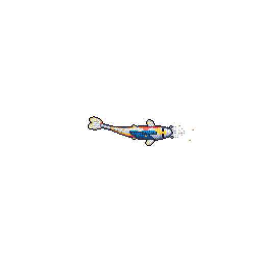

<h1 align="center">✨ Hello there! I’m Aarya Kanitkar ✨</h1>

  

  

  <i>“The Force is strong with curious minds.”</i>

---

## 🌌 About Me

I’m interested in **Language Models, Agentic AI and building software that solves real-world problems**. I like exploring how technology can make systems more useful, accessible, and intelligent.

---

## 🚀 Current Missions

- 🔬 **Research and Development Intern** — building and scaling a camera-based attendance system for college departments.
- 🔊 Developing a voice-first PDF reader featuring an AI assistant, designed for the visually impaired.
- ⚛️ Building a virtual lab for the Quantum Physics Department.

## 🛠️ My Toolkit

  
  
  
  
  
  
  
  
  
  
  

---

  <i>Thanks for stopping by. May your builds be stable and your bugs stay far, far away.</i>

